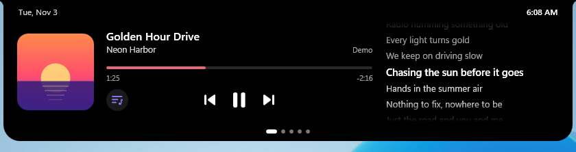
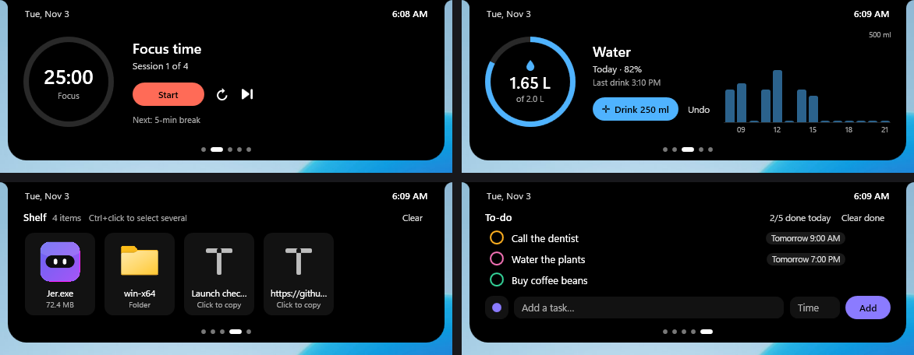
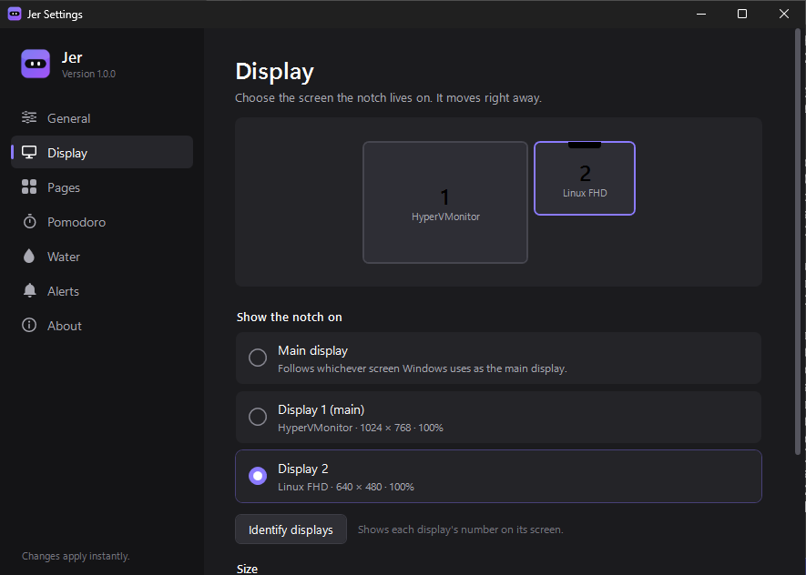

# Jer

**A living notch for Windows.** Jer puts a small black notch at the top of your screen that shows your music, synced lyrics, timers, files and reminders, then gets out of the way. Hover it to open, move away to close.

Inspired by [Nusa](https://rama2555.github.io/nusa/). Jer is an independent app written from scratch.






## Features

- **Music from any player**: Spotify, Apple Music, Media Player and browsers (YouTube) through the Windows media controls. Play, pause, skip, seek, and a volume slider on hover.
- **Synced lyrics** from [LRCLIB](https://lrclib.net). The open notch splits in two and lights up each line; click a line to jump there. A small lyrics pill follows the song while the notch is closed.
- **Pomodoro** focus timer with short and long breaks and a soft chime.
- **Water reminder** with a daily goal, a drink log and an hourly chart.
- **Shelf**: drag files or text onto the notch, drag them out into a chat, email or folder. Ctrl/Shift+click to select several. Files stay where they are; Jer only remembers the path.
- **To-do** with reminder times, task colours and snooze.
- **Overlays** for volume, Caps Lock, keyboard language, charger/battery and Wi-Fi/internet.
- **Mascot**: when your PC is idle, the clock steps aside for a pair of eyes that blink, doze off and say hello when you're back.

  

- **Settings window** (tray icon, the gear in the page bar, or start `Jer.exe` again). Every change applies instantly.
- **Display picker**: put the notch on the main display or on any other display (second screen, third...). Pick it in *Settings → Display* (with a map of your screens and an *Identify* button) or from the tray menu under *Show notch on*. If that display is unplugged, Jer falls back to the main display and moves back when it returns.
- Hides for full-screen games, videos and slides; minimal-notch mode; notch size; start with Windows; sharp on every display scale (per-monitor DPI).

### Settings and the display picker



## Download

Every push builds `Jer.exe` on GitHub Actions (tab **Actions → Build → Artifacts**):

- `Jer-win-x64`: most PCs
- `Jer-win-arm64`: Windows on ARM (Snapdragon)

Tagging a version (`git tag v1.0.0 && git push --tags`) also publishes a GitHub Release with both zips.

`Jer.exe` is self-contained: no installer and no .NET install needed. Requires Windows 10 1809 or later, or Windows 11 (64-bit). Windows SmartScreen may warn about a new unsigned app; choose **More info → Run anyway**.

## Using Jer

| Where | What |
| --- | --- |
| Hover the notch | Opens it. Move away and it closes. |
| Mouse wheel / ← → | Switch pages. Hover the page dots for icons and the Settings gear. |
| Drag onto the notch | Adds files or text to the Shelf. |
| Tray icon (left click) | Opens Settings. Right click for quick switches and the display picker. |
| Run `Jer.exe` again | Opens Settings in the copy that is already running. |

Command-line options: `--settings [General|Display|Pages|Pomodoro|Water|Alerts|About]` opens Settings on a page; `--demo` shows sample content without touching your data; `--pin <Music|Pomodoro|Water|Shelf|Todo>` keeps the notch open on a page.

## Privacy

Tasks, the water log, the shelf and settings are stored only on your PC in `%APPDATA%\Jer`. There are no accounts and no analytics. While synced lyrics are on, Jer sends the song title, artist, album and length to LRCLIB to find lyrics. Jer reads whether Caps Lock is on and which keyboard language is active; it never records what you type.

## Build from source

Requires the [.NET 10 SDK](https://dotnet.microsoft.com/download).

```powershell
dotnet build Jer.sln -c Release
dotnet run --project src/Jer

# single self-contained exe
dotnet publish src/Jer/Jer.csproj -c Release -r win-x64 --self-contained true -p:PublishSingleFile=true -p:EnableCompressionInSingleFile=true -o publish
```

The project also compiles on Linux/macOS (`EnableWindowsTargeting`), but it only runs on Windows. `build/smoke-test.ps1` starts the exe, drives it with the mouse and saves screenshots; CI runs it on every build.

## Project layout

```
src/Jer
├── App.xaml(.cs)         startup, single instance, wiring
├── Views/                NotchWindow (the notch), SettingsWindow, display identifier
├── ViewModels/           Music, Pomodoro, Water, Shelf, To-do, Settings, notch state
├── Services/             media (SMTC), lyrics (LRCLIB), volume (Core Audio), displays,
│                         tray, start-up, system watcher (idle, full screen, power, network)
├── Interop/              Win32 / COM declarations
├── Themes/               icons and control styles
└── Assets/               icons (generated by tools/make_icons.py)
```

## Ringkasan (Bahasa Indonesia)

Jer adalah notch untuk Windows: musik, lirik tersinkron, Pomodoro, pengingat minum, Shelf untuk file, dan to-do, langsung di bagian atas layar. Buka **Settings** lewat ikon Jer di tray (dekat jam). Di **Settings → Display** kamu bisa memindahkan notch ke layar utama atau ke layar kedua (atau layar lain), lengkap dengan peta layar dan tombol *Identify*. Pilihan yang sama ada di menu tray: *Show notch on*. Unduh `Jer.exe` dari tab **Actions** (artifact `Jer-win-x64`).
